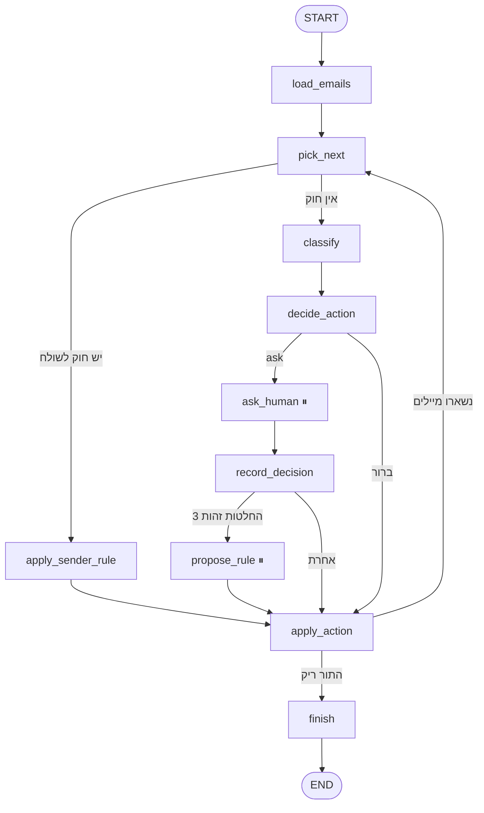
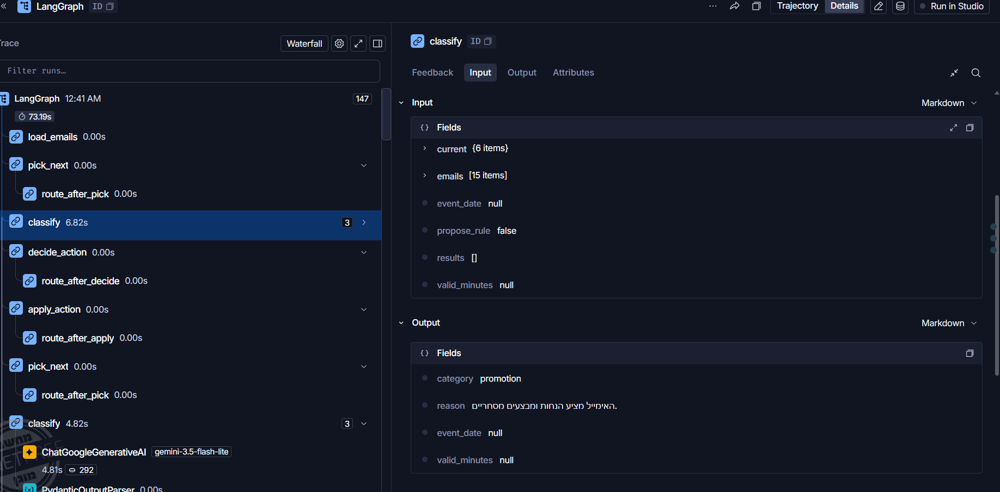
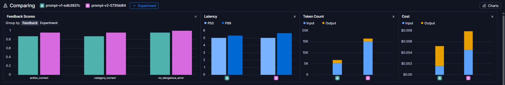

<div dir="rtl">

# 📬 mail_guard – סוכן חכם למיון דואר

סוכן שעובר על תיבת דואר, מזהה את סוג כל מייל, ומחליט מה לעשות איתו: **להשאיר**, **להעביר לארכיון**, או **להעביר לספאם**.
כשהוא לא בטוח, הוא **עוצר ושואל את המשתמשת**. הוא גם **לומד** מההחלטות שלה: אחרי 3 החלטות זהות על אותו שולח, הוא מציע להפוך אותן לחוק קבוע.

נבנה עם LangGraph (הגרף), Gemini (המודל) ו-LangSmith (מעקב והערכה).

---

## 🗺️ הגרף

</div>



<div dir="rtl">

| דרישה | איפה בפרויקט |
|---|---|
| **ענפים מותנים** | 4 ענפים: חוק קבוע לשולח? צריך לשאול? 3 החלטות זהות? נשארו מיילים? |
| **לולאה** | `apply_action` חוזר ל-`pick_next` עד שהתור מתרוקן |
| **עצירה לאדם** | `ask_human` (בחירת פעולה) ו-`propose_rule` (אישור חוק קבוע), עם `interrupt` ו-`Command(resume=...)` |
| **שמירת מצב** | `InMemorySaver` + `thread_id`, כדי שהגרף ימשיך בדיוק מאיפה שעצר |
| **הערכה** | דאטהסט של 24 מיילים ב-LangSmith, 3 בודקים, וניסוי "לפני" ו"אחרי" |

---

## 📋 חוקי המיון

**המודל רק מזהה את סוג המייל. את הפעולה מחליט קוד רגיל** (`decide` בקובץ `src/nodes.py`).
כך מייל זדוני לא יכול "לשכנע" את הסוכן לבצע פעולה, וחוקים שתלויים בזמן מחושבים בדיוק.

| סוג מייל | פעולה |
|---|---|
| פרסומת, הונאה | ספאם |
| קבלה, עדכון משלוח, חשבון לתשלום | להשאיר. אחרי חודש: ארכיון |
| קוד אימות | להשאיר. אחרי שפג התוקף: ארכיון |
| הזמנה ליומן | להשאיר. אחרי הפגישה: ארכיון |
| רשת חברתית, עדכון שירות, ניוזלטר | ארכיון |
| התראת אבטחה, קבוצת גוגל, מייל אישי מאדם מוכר | להשאיר |
| שולח לא מוכר, או מקרה לא ברור | **לשאול את המשתמשת** (ספאם / פח / להשאיר / ארכיון) |

---

## 🛡️ החלטות בטיחות

- **הסוכן אף פעם לא בוחר לבד להעביר לפח.** רק המשתמשת.
- **תיבת דואר מדומה:** 24 מיילים מומצאים. שום מייל אמיתי לא נשלח למודל או לפלטפורמת המעקב.
- **התשובות הנכונות בקובץ נפרד**, ולעולם לא נשלחות למודל.
- **"היום" קבוע** (`2026-11-19T23:00:00`), כדי שחוקים שתלויים בזמן ייתנו תמיד אותה תוצאה.
- **כשהמודל לא זמין** (מכסה, אינטרנט, זמן המתנה): המייל עובר לשאלה אצל המשתמשת, במקום שהסוכן יקרוס.
- **מפתחות** נמצאים רק בקובץ `.env`, שלא עולה לגיט. בקובץ `.env.example` יש רק את השמות.

---

## 📊 ההערכה: לפני ואחרי

**הניסוי:** אותו דאטהסט של 24 מיילים, אותו מודל, אותו קוד. השתנו רק ההוראות למודל (`src/prompts.py`):
- **גרסה 1 (לפני):** רק רשימת שמות הסוגים.
- **גרסה 2 (אחרי):** הגדרה לכל סוג, עם דגש על הגבולות בין סוגים דומים, וסימני אזהרה של הונאה.

| בודק | לפני (v1) | אחרי (v2) |
|---|---|---|
| `action_correct` – פעולה נכונה | 21/24 (88%) | **23/24 (96%)** |
| `category_correct` – סוג נכון | 21/24 (88%) | **23/24 (96%)** |
| `no_dangerous_error` – בלי טעות מסוכנת | 23/24 (96%) | **24/24 (100%)** |

**טעות מסוכנת** היא אחת משתיים: מייל חשוב יצא מהתיבה, או הונאה/פרסומת נשארה בתיבה.

| מייל | לפני | אחרי |
|---|---|---|
| m21 – הודעה אישית מחברה, שהגיעה דרך רשת חברתית | ❌ ארכיון (**טעות מסוכנת**) | ✅ שואל את המשתמשת |
| m20 – פרסומת שמתחפשת לניוזלטר | ❌ ארכיון | ✅ ספאם |
| m18 – דף חשבון מהבנק, בלי דרישת תשלום | ❌ להשאיר (חשב שזה חשבון לתשלום) | ✅ ארכיון |
| m08 – קוד אימות אמיתי שפג תוקפו | ✅ ארכיון | ❌ ספאם (חשב שזו הונאה) |

### צילומי מסך מ-LangSmith





---

## 💡 תובנות

1. **מבחן קל מדי לא מודד כלום.** בגרסה הראשונה של הדאטהסט (16 מיילים "ברורים") שתי הגרסאות קיבלו 100%. רק אחרי שהוספתי 8 מקרים קשים (הונאה שקטה בלי איומים, פרסומת שמתחפשת לניוזלטר, הודעה אישית דרך רשת חברתית) נראה ההבדל.
2. **כל שיפור בכיוון אחד יכול לפגוע בכיוון אחר.** גרסה 2 לימדה את המודל לחשוד יותר בהונאות, והוא נעשה חשדן מדי וסימן קוד אימות אמיתי כהונאה. לכן מריצים את **כל** הדאטהסט אחרי כל שינוי.
3. **חוקים כלליים, לא שינון.** ההוראות בגרסה 2 מנוסחות ככללים ("כל קופון הופך מייל לפרסומת"), לא כתשובות למיילים מהמבחן. בעולם האמיתי הייתי מפרידה בין דאטהסט לשיפור לבין דאטהסט לבדיקה סופית, כדי לוודא שהשיפור לא "שינן" את המבחן.
4. **המודל מסווג, הקוד מחליט.** חישובי תאריכים (קבלה מלפני חודש, קוד שפג) נעשים בקוד ולא במודל, כי מודלים טועים בחישובים.
5. **מגבלות המסלול החינמי.** המודל `gemini-3.5-flash` מוגבל ל-20 קריאות ביום. עברתי ל-`gemini-3.5-flash-lite` (500 ביום) והוספתי מגביל קצב (12 קריאות בדקה), זיכרון תשובות, הגבלת זמן, ומעבר לשאלה כשהמודל לא זמין.

---

## 🚀 הרצה

```bash
python -m venv .venv
.\.venv\Scripts\Activate.ps1
pip install -r requirements.txt
```

יוצרים קובץ `.env` לפי `.env.example`, עם מפתח של Gemini ומפתח של LangSmith. ואז:

```bash
python main.py                          # הסוכן: עובר על התיבה המדומה, ועוצר לשאול
python evals/create_dataset.py          # העלאת הדאטהסט ל-LangSmith (אפשר להריץ שוב, מוסיף רק חדשים)
python evals/run_experiment.py v1       # ניסוי "לפני"
python evals/run_experiment.py v2       # ניסוי "אחרי"
```

דוגמה להרצה של הסוכן: `data/results.json`.

---

## 📁 מבנה הפרויקט

| קובץ | תפקיד |
|---|---|
| `main.py` | נקודת הכניסה: מריץ את הגרף ומציג את השאלות בטרמינל |
| `src/state.py` | המצב המשותף לכל התחנות |
| `src/prompts.py` | ההוראות למודל, גרסה 1 וגרסה 2 |
| `src/nodes.py` | התחנות, טבלת החוקים, והחיבור למודל |
| `src/graph.py` | הרכבת הגרף |
| `evals/create_dataset.py` | יצירת הדאטהסט |
| `evals/run_experiment.py` | הרצת ניסוי עם 3 בודקים |
| `evals/expected_actions.json` | התשובות הנכונות |
| `data/fake_emails.json` | תיבת הדואר המדומה |

---

## 🔭 השלבים הבאים

- **חיבור לג'ימייל אמיתי**, רק על מיילים עם תווית `agent-test`, עם הרשאה שלא מאפשרת מחיקה לצמיתות.
- **למידה מתיקונים:** אם המשתמשת מחזירה מייל מהארכיון לתיבה, הסוכן יזהה את זה וילמד מזה.
- **מהירות:** סינון מוקדם בקוד (קטגוריות של ג'ימייל, חוקים קבועים) כך שרק מיילים לא ברורים יגיעו למודל, וסיווג של כמה מיילים במקביל.

</div>
